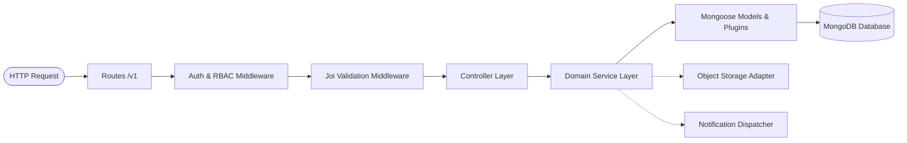
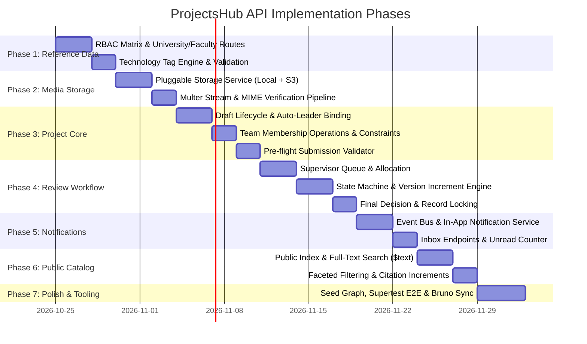
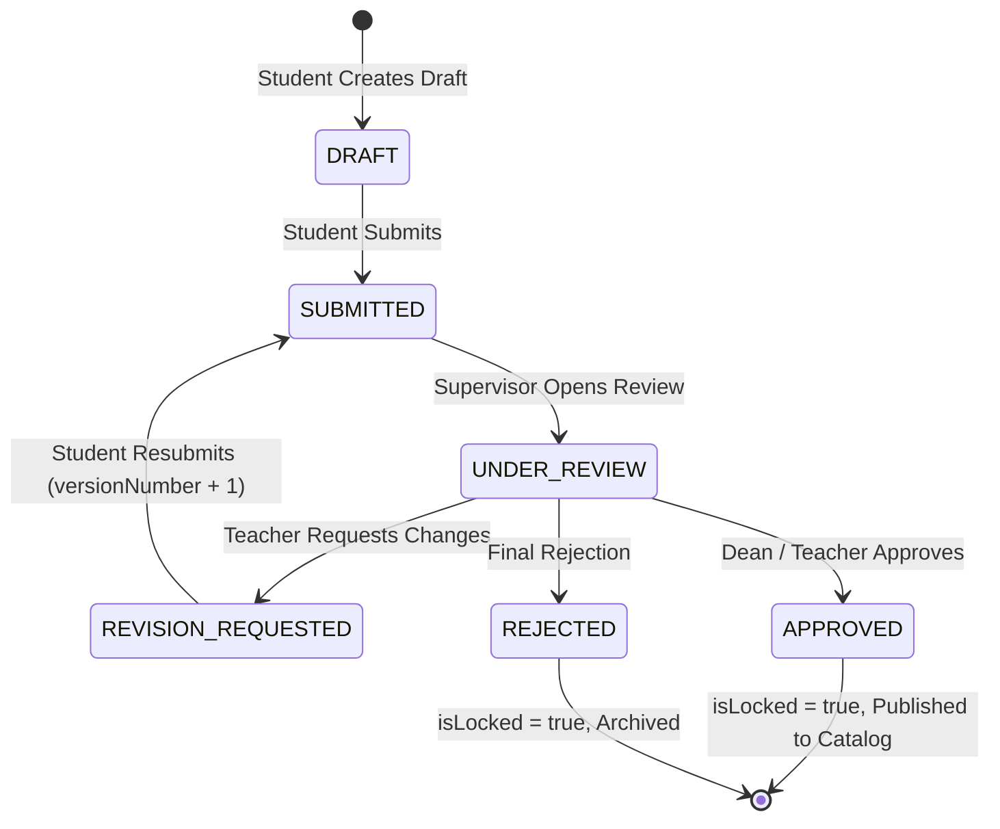

# ProjectsHub API — Architecture & Phased Development Plan

> **Target Version**: `1.0.0-rc`  
> **Status**: Approved Blueprint  
> **Audience**: Core Maintainers, Open-Source Contributors, Technical Reviewers  
> **Base Codebase**: `apps/api` (Node.js, Express, MongoDB/Mongoose)

---

## 1. Executive Summary & Vision

**ProjectsHub** is an open-source academic repository platform built to bridge the gap between student capstone projects/theses and institutional discovery. It enables academic institutions to archive monographs, index open-source deliverables, facilitate supervisor reviews, and provide public discovery via faceted search.

This document serves as the **definitive engineering roadmap** for developing the RESTful API services located in [`apps/api`](file:///Users/apple/Desktop/Projects/Personal/projects-hub/apps/api). It translates the established domain models into an enterprise-grade, battle-tested API adhering to Clean Architecture principles, strict RBAC guardrails, and industry-standard developer ergonomics.

---

## 2. Architectural Principles & Coding Standards

All contributions to the API must conform to the following architectural conventions:



### 2.1 Layered Separation of Concerns
1. **Routes (`src/routes/v1/`)**: Pure routing definitions, middleware pipelines (`auth()`, `validate()`), and OpenAPI Swagger annotations. No business logic.
2. **Validations (`src/validations/`)**: Declarative Joi schemas for `body`, `query`, and `params`. Validation occurs before request reaches controllers.
3. **Controllers (`src/controllers/`)**: HTTP boundary handlers. Responsible only for parsing inputs (`req.params`, `req.body`, `req.query`, `req.user`), calling domain services, and returning formatted JSON envelopes. Wrapped in `catchAsync`.
4. **Services (`src/services/`)**: Isolated business logic, database transactions, state machine transitions, event dispatching, and external integrations. Throws domain-specific `ApiError` instances.
5. **Models (`src/models/`)**: Mongoose schemas, document methods, static queries, plugins (`toJSON`, `paginate`, `publicId`), and compound/text indexes.

### 2.2 Standardized API Responses & Status Codes
- **Success Responses**:
  - `200 OK`: Successful retrieval or update.
  - `201 Created`: Resource successfully created. Returns the created entity.
  - `204 No Content`: Successful deletion or state change with no payload.
- **Error Envelopes**:
  All errors follow the RFC 7807 problem details specification handled by [`src/middlewares/error.js`](file:///Users/apple/Desktop/Projects/Personal/projects-hub/apps/api/src/middlewares/error.js):
  ```json
  {
    "code": 400,
    "message": "\"title\" is required",
    "stack": "..." // Only present in development mode
  }
  ```
- **Paginated Envelopes**:
  Endpoints returning collections use the `paginate` plugin:
  ```json
  {
    "results": [ ... ],
    "page": 1,
    "limit": 10,
    "totalPages": 4,
    "totalResults": 38
  }
  ```

### 2.3 Public ID Convention & Security
- Internal MongoDB `_id` values are never exposed in external REST contracts.
- All entities use URL-safe, prefix-identified `publicId` strings via the `publicId` plugin:
  - Users: `usr_xxxxxxxx`
  - Projects: `prj_xxxxxxxx`
  - Universities: `uni_xxxxxxxx`
  - Faculties: `fac_xxxxxxxx`
  - Tags: `tag_xxxxxxxx`
  - Notifications: `ntf_xxxxxxxx`

---

## 3. RBAC Matrix & Permission Granularity

The current permissions in [`src/config/roles.js`](file:///Users/apple/Desktop/Projects/Personal/projects-hub/apps/api/src/config/roles.js) must be expanded to enforce least-privilege access across academic workflows:

| Permission | Student | Teacher | Faculty Dean | Super Admin | Description |
|---|:---:|:---:|:---:|:---:|---|
| `getInstitutions` | ✅ | ✅ | ✅ | ✅ | Read university and faculty hierarchies |
| `manageInstitutions` | ❌ | ❌ | Partial* | ✅ | Create/update universities, faculties, departments |
| `getTags` | ✅ | ✅ | ✅ | ✅ | Query technology tags for filtering & project creation |
| `manageTags` | ❌ | ✅ | ✅ | ✅ | Create, categorize, or curate technology tags |
| `createProject` | ✅ | ❌ | ❌ | ✅ | Initialize draft projects |
| `manageOwnProject` | ✅ | ❌ | ❌ | ✅ | Edit metadata, add members to owned draft projects |
| `submitProject` | ✅ | ❌ | ❌ | ✅ | Submit project for academic supervisor review |
| `reviewProject` | ❌ | ✅ | ✅ | ✅ | Append review actions (approve, reject, revision) |
| `assignSupervisor` | ❌ | ❌ | ✅ | ✅ | Assign or reassign faculty supervisor to projects |
| `publishProject` | ❌ | ❌ | ✅ | ✅ | Final dean sign-off (unlocks public catalog view) |
| `getNotifications` | ✅ | ✅ | ✅ | ✅ | Access user notification inbox |
| `manageUsers` | ❌ | ❌ | Partial* | ✅ | Provision or update departmental student/teacher accounts |

*\*Note: Faculty Deans are scoped exclusively to their own `institutionId` and `facultyId`.*

---

## 4. Master Phased Implementation Roadmap



---

### Phase 1: Academic Reference Data & RBAC Foundation

#### 1.1 Objectives
Build the institutional hierarchies required by user profiles and project submissions:
- Universities (Institutions)
- Faculties & Embedded Departments
- Technology Tags

#### 1.2 Endpoints Specification

##### Universities & Faculties
- `GET /v1/universities`: List all active institutions. (Public or Authenticated)
- `POST /v1/universities`: Register an institution. (Requires `manageInstitutions`)
- `GET /v1/universities/:universityId`: Detailed institution profile.
- `GET /v1/universities/:universityId/faculties`: List faculties under an institution with embedded departments.
- `POST /v1/universities/:universityId/faculties`: Add faculty with initial departments. (Requires `manageInstitutions`)
- `POST /v1/universities/:universityId/faculties/:facultyId/departments`: Append department to faculty array.

##### Technology Tags
- `GET /v1/tags`: Query tags with optional `?category=backend|frontend|ai|mobile` and pagination.
- `POST /v1/tags`: Create tag with auto-slugification (e.g., `Node.js` -> `node-js`). (Requires `manageTags`)
- `GET /v1/tags/:tagId`: Tag details and project usage count.

#### 1.3 Key Architectural Deliverables
- [`src/config/roles.js`](file:///Users/apple/Desktop/Projects/Personal/projects-hub/apps/api/src/config/roles.js): Synchronize expanded permissions.
- [`src/validations/university.validation.js`](file:///Users/apple/Desktop/Projects/Personal/projects-hub/apps/api/src/validations/): Joi schemas validating domain uniqueness and department structures.
- [`src/services/university.service.js`](file:///Users/apple/Desktop/Projects/Personal/projects-hub/apps/api/src/services/): Atomic MongoDB update operations (`$push`, `$pull` for embedded departments).
- [`src/services/technologyTag.service.js`](file:///Users/apple/Desktop/Projects/Personal/projects-hub/apps/api/src/services/): Slug collision avoidance and cacheable tag dictionary.

---

### Phase 2: Media Storage & Secure Upload Pipeline

#### 2.1 Objectives
Provide unified upload handling for project deliverables:
1. **Monographs**: Academic thesis/report (PDF format, up to 25MB).
2. **Software Screenshots**: UI/UX previews (JPEG, PNG, WebP format, up to 5MB each, max 5 files).

#### 2.2 Storage Architecture Pattern
Implement an extensible adapter in `src/utils/storage/`:
- **Local Driver (`LocalStorageProvider`)**: Saves files to `apps/api/uploads/` (ideal for zero-dependency local dev and CI/CD).
- **S3 Driver (`S3StorageProvider`)**: Streams uploads to AWS S3, Cloudflare R2, or MinIO via AWS SDK v3.

#### 2.3 Endpoints Specification
- `POST /v1/uploads/monograph`: Single PDF file. Returns `{ fileUrl: "...", originalName: "...", size: 12345 }`.
- `POST /v1/uploads/screenshots`: Multi-part array of images (`maxCount: 5`). Returns `{ fileUrls: [ "..." ] }`.

#### 2.4 Security & Validation Guardrails
- Magic number / MIME type verification (prevents renaming `.exe` to `.pdf`).
- File name sanitization with UUID or cryptographically random hashes (`crypto.randomUUID() + path.extname(file.originalname)`).
- Rate-limiting upload endpoints to prevent disk exhaustion attacks.

---

### Phase 3: Project Authoring Core & Team Lifecycle

#### 3.1 Objectives
Enable enrolled students to initialize project drafts, attach research/code deliverables, recruit fellow student team members, and prepare for academic submission.

#### 3.2 Endpoints Specification
- `POST /v1/projects`: Create project draft.
  - *Behavior*: Automatically copies `req.user._id`, `studentId`, and `fullName` into the `leader` sub-document. Initial state: `status: 'draft'`, `versionNumber: 1`, `isLocked: false`.
- `GET /v1/projects/my-projects`: List projects where `leader.userId === req.user._id` OR `members.userId === req.user._id`.
- `GET /v1/projects/:projectId`: Retrieve full project document.
  - *Access Guard*: Available to project leader, team members, assigned supervisor, faculty dean, and super admin.
- `PATCH /v1/projects/:projectId`: Incremental update of metadata, monograph details, software links, or technology tags.
  - *Business Invariant*: Blocked if `isLocked === true` or if `status === 'submitted'`. Allowed only when status is `draft` or `revision_requested`.
- `POST /v1/projects/:projectId/members`: Add team member.
  - *Validation*: Accepts `{ studentId }` or `{ userId }`. Verifies that the user exists, belongs to the same institution/faculty, is not already on the team, and has not exceeded maximum team size (default: 4 members).
- `DELETE /v1/projects/:projectId/members/:userId`: Remove team member (callable by project leader).
- `POST /v1/projects/:projectId/submit`: Formal submission.
  - *Pre-flight Checklist*: Verifies non-empty title, abstract, monograph PDF URL, supervisor assigned/selected, and graduation year. Transitions status from `draft` to `submitted`.

---

### Phase 4: Review Workflow, State Transitions & Locking

#### 4.1 State Machine Specification



#### 4.2 State Invariants & Rules
1. **Locking**: When status becomes `approved` or `rejected`, `isLocked` MUST be set to `true`. No further modifications to members, monograph, or software are permitted.
2. **Version Bumping**: When resubmitting from `revision_requested`, `versionNumber` increments by 1 (`v1 -> v2`).
3. **Audit Trail**: Each evaluation adds an entry to `reviews[]`:
   - `reviewerId`: ID of the supervisor or dean.
   - `action`: `'approve' | 'reject' | 'request_revision'`
   - `feedbackText`: Detailed evaluation comments.
   - `versionAtReview`: Snapshot of `project.versionNumber` at review time.
   - `createdAt`: Timestamp.

#### 4.3 Endpoints Specification
- `GET /v1/projects/assigned`: Projects where `assignedTeacherId === req.user._id` (Requires role `teacher`).
- `PATCH /v1/projects/:projectId/assign-teacher`: Assign supervisor (Requires role `faculty_dean` or `super_admin`).
- `POST /v1/projects/:projectId/reviews`: Submit review decision and feedback.
  - *Permissions*: Only the assigned teacher, faculty dean, or super admin.

---

### Phase 5: Notification Service & Event Hooks

#### 5.1 Objectives
Deliver real-time transactional feedback to students and educators as projects move across lifecycle milestones.

#### 5.2 Event Hook Triggers
1. `PROJECT_SUBMITTED`: Alert assigned supervisor with project title and submission author.
2. `REVIEW_SUBMITTED (REVISION_REQUESTED)`: Alert team leader and members with review notes.
3. `PROJECT_APPROVED`: Alert students that their monograph is approved and published.
4. `PROJECT_REJECTED`: Alert students with rejection rationale.

#### 5.3 Endpoints Specification
- `GET /v1/notifications`: Paginated list of notifications for the authenticated user (`req.user._id`), sorted newest first (`createdAt: -1`).
- `GET /v1/notifications/unread-count`: Fast count query (`{ userId: req.user._id, isRead: false }`).
- `PATCH /v1/notifications/:notificationId/read`: Mark single notification as read.
- `PATCH /v1/notifications/read-all`: Mark all notifications as read for current user.

---

### Phase 6: Public Catalog, Advanced Search & Discovery

#### 6.1 Objectives
Provide an ultra-fast, publicly accessible discovery portal for research and software portfolios without requiring authentication.

#### 6.2 Search & Indexing Strategy
Leverages production indexes configured in [`project.model.js`](file:///Users/apple/Desktop/Projects/Personal/projects-hub/apps/api/src/models/project.model.js):
- **Full-Text Search (`$text`)**: Matches keywords across `title`, `monograph.abstract`, and `monograph.keywords`.
- **Faceted Compound Indexing**: Combines `{ status: 1, graduationYear: -1, facultyId: 1, departmentId: 1, 'software.techTagIds': 1 }` for high-throughput filter navigation.

#### 6.3 Endpoints Specification
- `GET /v1/projects/catalog`:
  - *Public Access*: No JWT required.
  - *Enforced Filter*: Hardcoded `{ status: 'approved' }`.
  - *Query Parameters*:
    - `search`: Text query string.
    - `graduationYear`: Exact match or range.
    - `facultyId`: Filter by faculty.
    - `departmentId`: Filter by department.
    - `techTagIds`: Comma-separated tag IDs (supports `$all` or `$in`).
    - `type`: `'universal' | 'science'`.
    - `sortBy`: e.g., `graduationYear:desc,citationCount:desc`.
    - `page`, `limit`: Standard pagination.
- `GET /v1/projects/catalog/:projectId`:
  - Returns public presentation view (hides internal review logs and non-public metadata).
- `POST /v1/projects/catalog/:projectId/cite`:
  - Atomically increments `monograph.citationCount` via `$inc: { 'monograph.citationCount': 1 }`.
  - Rate-limited per IP to prevent artificial citation inflation.

---

### Phase 7: Quality Assurance, Integration Testing & Documentation

#### 7.1 Testing Matrix (Jest & Supertest)
All modules must include integration tests under `apps/api/tests/integration/`:

| Test Suite | Primary Scenarios Covered |
|---|---|
| `university.test.js` | Create institution, reject duplicate domains, append departments. |
| `tag.test.js` | Tag creation, category filtering, slug generation, duplicate prevention. |
| `upload.test.js` | MIME verification, rejection of executable files, size threshold checks. |
| `project.lifecycle.test.js` | Create draft -> Add team member -> Submit -> Request revision -> Resubmit (version++) -> Final approval -> Verify locked state. |
| `catalog.test.js` | Public search, ensure drafts/rejected projects NEVER appear in public catalog. |
| `notification.test.js` | Automated dispatch on review events, mark as read, unread count. |

#### 7.2 Database Seed Enhancements
Expand [`src/seed/seed.js`](file:///Users/apple/Desktop/Projects/Personal/projects-hub/apps/api/src/seed/seed.js) to generate a realistic academic ecosystem for local development:
- 2 Universities (e.g., Kabul University, Herat University).
- 4 Faculties with 10+ Departments.
- 25 Categorized Technology Tags (React, Node.js, Flutter, PyTorch, Go, etc.).
- 20 Users across all roles (`student`, `teacher`, `faculty_dean`, `super_admin`).
- 15 Projects in diverse lifecycle states (`draft`, `submitted`, `revision_requested`, `approved`).

#### 7.3 Developer Experience & API Documentation
- **Swagger / OpenAPI 3.0**: Embedded JSDoc annotations in `src/routes/v1/*.js` served at `/v1/docs`.
- **Bruno Collection**: Keep HTTP requests up-to-date in [`apps/api/bruno/`](file:///Users/apple/Desktop/Projects/Personal/projects-hub/apps/api/bruno) with sample environments (`local`, `production`) and pre-request token generation scripts.

---

## 5. Open-Source Contribution & Review Checklist

When submitting a Pull Request for any endpoint in this plan, verify the following:

- [ ] **Route & Validation**: The route has an accompanying Joi validation schema verifying params, body, and query.
- [ ] **Authorization Guard**: The route uses `auth('permissionName')` or has an explicit rationale if public.
- [ ] **Public ID**: No raw MongoDB `_id` values leaked; all URL parameters use `publicId` strings.
- [ ] **Service Isolation**: Controllers only parse requests and send responses; all business logic lives in `*.service.js`.
- [ ] **Status Codes**: Returns standard HTTP status codes (`200`, `201`, `204`, `400`, `401`, `403`, `404`).
- [ ] **Unit / Integration Tests**: Passing Jest test cases verifying both happy paths and boundary error conditions.
- [ ] **Lint & Formatting**: `npm run lint` passes without warnings; Prettier applied.
- [ ] **Documentation**: OpenAPI Swagger annotations and Bruno collection updated.

---

*Authored by the ProjectsHub Core Engineering Team. Open for community discussion and feature proposals.*
