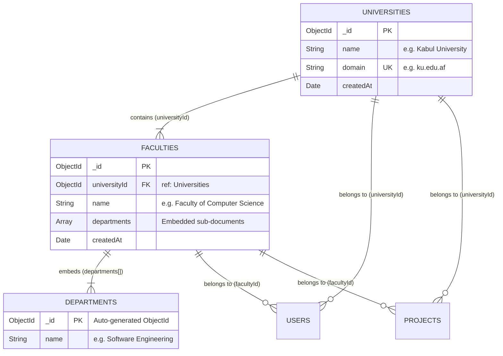
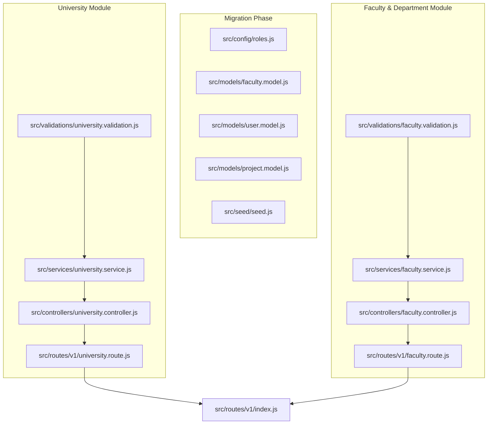

# Task 2: Universities, Faculties & Embedded Departments — Revised Implementation Plan

> **Phase**: Phase 1 of Master Plan ([`API_DEVELOPMENT_PLAN.md`](file:///Users/apple/Desktop/Projects/Personal/projects-hub/apps/api/docs/API_DEVELOPMENT_PLAN.md))  
> **Status**: Ready for Review & Approval  
> **Target Scope**: Terminology standardization (`institution` ➔ `university`), University CRUD, Faculty management, and Embedded Department operations  

---

## 1. Overview & Architectural Analysis

### The Problem
Previously, the codebase used two competing terms interchangeably:
1. Generic **`institution`** (`institutionId`, `manageInstitutions`, `getInstitutions`, `sampleInstitutions`).
2. Concrete **`university`** (`University` model, `/v1/universities`, `universityId`).

### The Decision
Standardize on **`university`** across all layers of the stack:
- **`University`** is the top-level academic entity (collection: `universities`).
- **`Faculty`** belongs to a `University` via `universityId` (ref: `University`).
- **`Department`** is an embedded sub-document inside `Faculty.departments[]`.
- RBAC permissions: `manageUniversities` and `getUniversities`.

---

## 2. API Contract Specification

### Universities Endpoints (`/v1/universities`)
| Method | Endpoint | Auth / Permission | Description |
|---|---|---|---|
| `POST` | `/v1/universities` | `auth('manageUniversities')` | Register a university (unique domain required) |
| `GET` | `/v1/universities` | Public | Paginated list with `name` and `domain` search |
| `GET` | `/v1/universities/:universityId` | Public | Fetch specific university by ID |
| `PATCH` | `/v1/universities/:universityId` | `auth('manageUniversities')` | Update university name or domain |
| `DELETE` | `/v1/universities/:universityId` | `auth('manageUniversities')` | Remove university (prevent or cascade-delete faculties) |

### Faculties & Embedded Departments Endpoints
| Method | Endpoint | Auth / Permission | Description |
|---|---|---|---|
| `POST` | `/v1/universities/:universityId/faculties` | `auth('manageUniversities')` | Create faculty linked to `universityId` |
| `GET` | `/v1/universities/:universityId/faculties` | Public | List all faculties & departments for a university |
| `GET` | `/v1/faculties/:facultyId` | Public | Fetch faculty details & embedded departments |
| `PATCH` | `/v1/faculties/:facultyId` | `auth('manageUniversities')` | Update faculty name |
| `DELETE` | `/v1/faculties/:facultyId` | `auth('manageUniversities')` | Remove faculty |
| `POST` | `/v1/faculties/:facultyId/departments` | `auth('manageUniversities')` | Atomically append department (`$push`) |
| `DELETE` | `/v1/faculties/:facultyId/departments/:departmentId` | `auth('manageUniversities')` | Atomically remove department (`$pull`) |

---

## 3. Step-by-Step Implementation Architecture

---

### Step 1: Model & Schema Migration (`institutionId` ➔ `universityId`)
Align existing models and configurations with the unified terminology:
1. **[`src/config/roles.js`](file:///Users/apple/Desktop/Projects/Personal/projects-hub/apps/api/src/config/roles.js)**:
   - Replace `getInstitutions` ➔ `getUniversities`
   - Replace `manageInstitutions` ➔ `manageUniversities`
2. **[`src/models/faculty.model.js`](file:///Users/apple/Desktop/Projects/Personal/projects-hub/apps/api/src/models/faculty.model.js)**:
   - Rename `institutionId` ➔ `universityId` (`ref: 'University'`)
   - Update index: `facultySchema.index({ universityId: 1 })`
3. **[`src/models/user.model.js`](file:///Users/apple/Desktop/Projects/Personal/projects-hub/apps/api/src/models/user.model.js)**:
   - Rename `institutionId` ➔ `universityId`
   - Update compound partial index: `{ studentId: 1, universityId: 1 }`
4. **[`src/models/project.model.js`](file:///Users/apple/Desktop/Projects/Personal/projects-hub/apps/api/src/models/project.model.js)**:
   - Rename `institutionId` ➔ `universityId`
5. **[`src/seed/seed.js`](file:///Users/apple/Desktop/Projects/Personal/projects-hub/apps/api/src/seed/seed.js)**:
   - Rename `sampleInstitutions` ➔ `sampleUniversities`
   - Seed faculties using `universityId`

---

### Step 2: Validation Layer (Joi)
1. **`src/validations/university.validation.js`**:
   - `createUniversity`: `body: { name: Joi.string().required(), domain: Joi.string().required().lowercase() }`
   - `getUniversities`: `query: { name, domain, sortBy, limit, page }`
   - `getUniversity`: `params: { universityId: objectId }`
   - `updateUniversity`: `params: { universityId: objectId }`, `body: { name, domain }`
   - `deleteUniversity`: `params: { universityId: objectId }`
2. **`src/validations/faculty.validation.js`**:
   - `createFaculty`: `params: { universityId: objectId }`, `body: { name: Joi.string().required(), departments: Joi.array().items(Joi.object({ name: Joi.string().required() })) }`
   - `getFaculties`: `params: { universityId: objectId }`, `query: { name, sortBy, limit, page }`
   - `getFaculty`: `params: { facultyId: objectId }`
   - `updateFaculty`: `params: { facultyId: objectId }`, `body: { name: Joi.string().required() }`
   - `deleteFaculty`: `params: { facultyId: objectId }`
   - `createDepartment`: `params: { facultyId: objectId }`, `body: { name: Joi.string().required() }`
   - `deleteDepartment`: `params: { facultyId: objectId, departmentId: objectId }`
3. Export in [`src/validations/index.js`](file:///Users/apple/Desktop/Projects/Personal/projects-hub/apps/api/src/validations/index.js).

---

### Step 3: Domain Service Layer
1. **`src/services/university.service.js`**:
   - `createUniversity(universityBody)`: Throws `400` if domain already registered.
   - `queryUniversities(filter, options)`: Paginated query using `University.paginate`.
   - `getUniversityById(id)`: Fetches university or throws `404`.
   - `updateUniversityById(universityId, updateBody)`: Re-checks domain collision if domain is changed.
   - `deleteUniversityById(universityId)`: Verifies if any faculties are currently attached before deleting.
2. **`src/services/faculty.service.js`**:
   - `createFaculty(universityId, facultyBody)`: Verifies university exists, saves faculty linked via `universityId`.
   - `queryFacultiesByUniversity(universityId, filter, options)`: Returns paginated faculties under that university.
   - `getFacultyById(id)`: Returns faculty document with embedded departments.
   - `updateFacultyById(facultyId, updateBody)`: Updates faculty name.
   - `deleteFacultyById(facultyId)`: Deletes faculty.
   - `addDepartment(facultyId, departmentBody)`: Uses atomic `$push: { departments: departmentBody }`.
   - `removeDepartment(facultyId, departmentId)`: Uses atomic `$pull: { departments: { _id: departmentId } }`.
3. Export in [`src/services/index.js`](file:///Users/apple/Desktop/Projects/Personal/projects-hub/apps/api/src/services/index.js).

---

### Step 4: Controllers & Express Routes
1. **`src/controllers/university.controller.js`**:
   - Thin handlers delegating to `universityService`.
2. **`src/controllers/faculty.controller.js`**:
   - Thin handlers delegating to `facultyService`.
3. **`src/routes/v1/university.route.js`**:
   - Routes for `/` (`POST`, `GET`)
   - Routes for `/:universityId` (`GET`, `PATCH`, `DELETE`)
   - Nested route for `/:universityId/faculties` (`POST`, `GET`)
4. **`src/routes/v1/faculty.route.js`**:
   - Route for `/:facultyId` (`GET`, `PATCH`, `DELETE`)
   - Routes for `/:facultyId/departments` (`POST`)
   - Routes for `/:facultyId/departments/:departmentId` (`DELETE`)
5. Mount both in [`src/routes/v1/index.js`](file:///Users/apple/Desktop/Projects/Personal/projects-hub/apps/api/src/routes/v1/index.js).

---

### Step 5: Integration Tests (Jest & Supertest)
1. **`tests/fixtures/university.fixture.js`** & **`tests/fixtures/faculty.fixture.js`**.
2. **`tests/integration/university.test.js`**:
   - Duplicate domain rejection (`400`).
   - Admin authorization check (`403` for student/guest, `201`/`200` for admin).
   - Domain and name search filtering.
3. **`tests/integration/faculty.test.js`**:
   - Create faculty under university (`201`).
   - Append embedded department via `$push` (`200`/`201`).
   - Remove embedded department via `$pull` (`200`/`204`).
   - Cascade / deletion handling.

---

### Step 6: Bruno API Collections
Create Bruno collections under:
- `apps/api/bruno/universities/`:
  - `01-Create-University.bru`
  - `02-Get-Universities.bru`
  - `03-Get-University-By-Id.bru`
  - `04-Update-University.bru`
  - `05-Delete-University.bru`
- `apps/api/bruno/faculties/`:
  - `01-Create-Faculty.bru`
  - `02-Get-Faculties-By-University.bru`
  - `03-Get-Faculty-By-Id.bru`
  - `04-Add-Department.bru`
  - `05-Remove-Department.bru`
  - `06-Delete-Faculty.bru`
