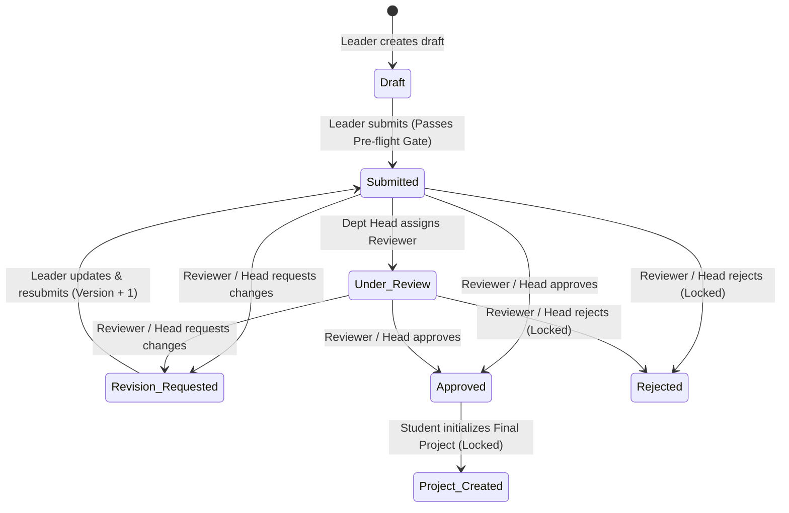
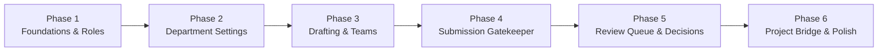

# 📋 Product & Functional Plan: Project Proposals Lifecycle & Department Review

> **Feature Scope**: Academic Approval Gate & Departmental Proposal Management  
> **Target Package**: [`apps/api`](file:///Users/apple/Desktop/Projects/Personal/projects-hub/apps/api)  
> **Format**: User Story & Workflow Plan (No-Code Functional Specification)  

---

## 1. Vision & Problem Statement

Before a student team can build and publish a final graduation project (monograph and software deliverable), their idea must first go through an **Academic Proposal & Approval Gate**. 

Different university departments operate differently:
- Some departments require students to upload a formal **signed PDF proposal**.
- Other departments prefer a **structured online form** (Introduction, Problem Statement, Objectives, Methodology, Expected Outcomes).
- Some allow **flexible** submissions (either format) and enforce strict **team size limits** and **submission deadlines**.

This plan defines **how the system works from a human and workflow perspective** (via User Stories) and breaks the delivery into **6 sequential phases**.

---

## 2. Personas & Actors

| Persona | Role in the Proposal Lifecycle |
|---|---|
| **Student (Team Leader)** | Initiates the proposal draft, invites/removes teammates, fills out the proposal or uploads the PDF, submits it for review, and responds to revision requests. |
| **Student (Team Member)** | Joins a proposal team, views the live status and reviewer feedback of the team's proposal, and is protected from being added to multiple competing proposals at once. |
| **Department Head / Faculty Dean** | Configures department-specific proposal rules (deadlines, team size, format), views the department's incoming proposal queue, assigns teachers to review, and approves, rejects, or requests revisions. |
| **Teacher (Assigned Reviewer)** | Views proposals specifically assigned to them by the Department Head and submits structured evaluation feedback and decisions. |
| **University Admin / Super Admin** | Sets university-wide default rules and oversees proposal activity across faculties and departments. |

---

## 3. End-to-End User Stories (How Things Will Be Done)

### Epic A: Departmental Rules & Configuration

#### Story A1: Customizing Department Proposal Rules
> **As a** Department Head or Faculty Dean,  
> **I want to** configure how students in my department submit project proposals (format, allowed project types, maximum team size, deadlines, and instructions),  
> **So that** all student submissions automatically follow our department's academic standards without manual policing.

**How it works:**
1. Every university has sensible **global default rules** (e.g., max 4 students per team, PDF submission mode, open submissions).
2. If a Department Head does nothing, their department automatically inherits those university defaults.
3. When the Department Head updates their department's settings, they can customize:
   - **Submission Format Mode**: PDF-only, Structured Form-only, or Flexible (student's choice).
   - **Allowed Project Types**: Universal, Science, or both.
   - **Maximum Team Size**: How many students (including the leader) can be on one team.
   - **Submission Window**: A toggle to open/close submissions immediately, plus an optional cutoff deadline date.
   - **Guidance**: A link to a template/guidelines document and custom written instructions for students.
4. Security ensures a Department Head can only change rules for their own department, and a Faculty Dean can only manage departments inside their own faculty.

#### Story A2: Viewing Department Requirements Before Starting
> **As a** Student,  
> **I want to** see my department's exact proposal rules, instructions, and deadline before I start writing,  
> **So that** I know whether to prepare a PDF or fill out the structured form, and how many teammates I can invite.

**How it works:**
1. When a student opens the proposal creation screen, the system fetches their department's active rules (automatically filling in any unconfigured rules from the university defaults).
2. The student immediately sees whether submissions are open, the deadline countdown, the required submission format, maximum team size, and downloadable guidelines.

---

### Epic B: Proposal Authoring & Team Formation

#### Story B1: Starting a Proposal Draft
> **As a** Student,  
> **I want to** start a new project proposal draft and automatically become its Team Leader,  
> **So that** I can save my progress incrementally before officially submitting it to the department.

**How it works:**
1. The student enters basic proposal details (such as a working title and project type) and saves it as a **Draft**.
2. The system automatically tags the proposal with the student's University, Faculty, and Department, and assigns the student as the **Team Leader**.
3. **One-Active-Proposal Rule**: Before creating the draft, the system checks if this student is already part of another active proposal (whether as a leader or member in a draft, submitted, under review, revision-requested, or approved proposal). If they are, the system prevents them from starting a second simultaneous proposal. Only if their previous proposal was permanently **Rejected** can they start a fresh one.

#### Story B2: Building the Student Team
> **As a** Student Team Leader,  
> **I want to** add and remove classmates from my proposal team while we are drafting or revising,  
> **So that** our entire group is officially registered on the proposal.

**How it works:**
1. While the proposal is in **Draft** or **Revision Requested** status, the Team Leader can add a classmate using their Kankor ID or User ID.
2. When adding a member, the system performs four automatic checks:
   - **Valid Student Check**: The invited person must be a registered student in the same university/faculty (and same department, unless cross-department teams are explicitly allowed by the department settings).
   - **No Duplicate Membership**: The student cannot already be on this team.
   - **Single Active Proposal Guard**: The invited student cannot already belong to another active proposal team.
   - **Team Size Quota**: Adding the student must not exceed the department's **Maximum Team Size** (counting the leader plus all members).
3. The Team Leader can also remove a team member at any time before the proposal is locked or submitted.
4. Regular team members can view the proposal and its feedback at any time, but only the **Team Leader** can edit the content, manage members, or delete an unsubmitted draft.

---

### Epic C: Formal Submission & Automated Pre-Flight Checks

#### Story C1: Submitting a Proposal for Department Review
> **As a** Student Team Leader,  
> **I want to** formally submit our completed proposal to the department,  
> **So that** our Department Head or assigned teacher can review and approve our topic.

**How it works:**
1. When the Team Leader triggers submission, the system acts as an automated **Gatekeeper**, verifying the proposal against the department's live rules:
   - **Window Check**: Are submissions currently open for this department, and is the current time before the submission deadline?
   - **Project Type Check**: Is the chosen project type allowed by the department?
   - **Content Completeness Check (based on Department Mode)**:
     - If the department requires **PDF Mode**: A valid proposal PDF must be uploaded.
     - If the department requires **Structured Form Mode**: The Introduction, Problem Statement, and at least one Objective must be filled out.
     - If the department allows **Flexible Mode**: At least one of the two (complete PDF *or* complete structured form) must be provided.
2. If any check fails, the system stops the submission and tells the student exactly what is missing or why submissions are closed.
3. If all checks pass:
   - The proposal status changes from **Draft** to **Submitted**.
   - While **Submitted**, the proposal becomes **read-only** to students so they cannot alter the content while teachers are evaluating it.

---

### Epic D: Department Review Queue, Evaluation & Revisions

#### Story D1: Viewing the Scoped Department Queue
> **As a** Department Head, Faculty Dean, or Assigned Teacher,  
> **I want to** view a filtered list of proposals that belong to my jurisdiction,  
> **So that** I can track pending submissions without seeing proposals from unrelated departments or universities.

**How it works:**
1. **Department Heads** automatically see only proposals submitted within their specific department.
2. **Faculty Deans** see proposals across all departments within their faculty, and can filter by department or status.
3. **Teachers** see proposals where they have been specifically assigned as the reviewer.
4. **University Admins** see proposals across their university.
5. Reviewers can filter the queue by status (e.g., *Submitted*, *Under Review*, *Approved*) and search by proposal title.

#### Story D2: Assigning a Teacher Reviewer (Optional Delegation)
> **As a** Department Head or Faculty Dean,  
> **I want to** assign a specific faculty teacher to evaluate a submitted proposal,  
> **So that** subject-matter experts can review proposals and share the evaluation workload.

**How it works:**
1. The Department Head selects a submitted proposal and assigns a teacher from their faculty.
2. The proposal status automatically moves from **Submitted** to **Under Review**, signaling to the student team that an evaluator is actively looking at their work.

#### Story D3: Evaluating a Proposal (Approve, Request Revision, or Reject)
> **As a** Reviewer (Department Head, Faculty Dean, or Assigned Teacher),  
> **I want to** record my decision and written feedback on a proposal,  
> **So that** the student team knows whether they can proceed to their project, need to improve their proposal, or must start over.

**How it works:**
1. Every evaluation decision records a permanent **Audit Trail entry** containing: who reviewed it, their decision, their written feedback comments, which version of the proposal they reviewed, and the timestamp.
2. Depending on the decision chosen by the reviewer:
   - **Request Revision**:
     - Status changes to **Revision Requested**.
     - The proposal unlocks for the Student Team Leader so they can edit the content, upload a revised PDF, or adjust team members based on the feedback.
     - When the leader resubmits, the proposal's **Version Number increases by 1** (e.g., Version 1 → Version 2) so reviewers can track how many revision cycles occurred.
   - **Approve**:
     - Status changes to **Approved**.
     - The student team is now officially cleared to begin their final graduation project!
   - **Reject**:
     - Status changes to **Rejected** and the proposal is **permanently locked**.
     - Because the proposal is now closed and rejected, the students on that team are freed from the "One-Active-Proposal" restriction and may create a brand-new proposal draft with a new topic.

---

### Epic E: Bridging Approved Proposals to Final Projects

#### Story E1: Turning an Approved Proposal into an Active Graduation Project
> **As a** Student Team Leader with an Approved Proposal,  
> **I want to** initialize our official Graduation Project directly from our approved proposal,  
> **So that** our approved team and topic seamlessly carry over into the final project workspace, and no unapproved projects can bypass the department.

**How it works:**
1. A final graduation project cannot be created out of thin air—it requires an **Approved Proposal**.
2. Each approved proposal can only be used to create **one** final project.
3. Once the final project is created from the proposal, the proposal links to that project and becomes **permanently locked** as a historical academic record.

---

## 4. Phased Delivery Roadmap (What Each Phase Does)

To build and verify this system safely without breaking existing features, the work is divided into **6 sequential phases**:

---

### Phase 1: Permissions, Data Foundations & Institutional Defaults
- **What this phase does**:
  - Sets up the foundational rules of who is allowed to do what across the platform (Students can create/manage/submit their proposals; Department Heads and Deans can configure department rules and review proposals; Teachers can review assigned proposals).
  - Establishes the storage structure for **Department Settings**, **System-wide Proposal Defaults**, and **Proposals** (including team members, version history, review logs, and unique public identifiers).
  - Prepares the link between a **Proposal** and a final **Project**.
- **User value unlocked**:
  - The system understands the concept of a Proposal, Department Rules, and the permissions of every academic role.
- **How we verify it**:
  - Verify that proposals generate clean public IDs, enforce required information, and that existing faculties/departments continue working seamlessly using default settings.

---

### Phase 2: Department Settings Management
- **What this phase does**:
  - Delivers **Stories A1 & A2**.
  - Allows Department Heads, Faculty Deans, and Admins to customize their department's proposal rules (submission format mode, allowed project types, max team size, open/closed toggle, submission deadline, guidelines link, and instructions).
  - Allows students and staff to view a department's active rules—automatically blending any custom department choices with university-wide fallback defaults so there are never missing settings.
  - Enforces strict territorial boundaries (a Department Head in Software Engineering cannot alter settings for Civil Engineering).
- **User value unlocked**:
  - Departments gain full autonomy over how they run their proposal intake, and students can check their department's exact expectations.
- **How we verify it**:
  - Test reading unconfigured department settings (confirming defaults appear), updating settings as an authorized Department Head, and confirming that unauthorized users (students or heads of other departments) are blocked.

---

### Phase 3: Proposal Drafting & Team Formation
- **What this phase does**:
  - Delivers **Stories B1 & B2**.
  - Enables students to create a new proposal draft, automatically assigning them as Team Leader and attaching their university, faculty, and department.
  - Enforces the **One-Active-Proposal Rule** so a student cannot lead or join multiple active proposals at the same time.
  - Allows the Team Leader to edit draft content, delete an unsubmitted draft, and invite or remove classmates.
  - Enforces team-building guardrails: invited members must be valid students in the right institution/faculty, cannot be in another active proposal, and total team size cannot exceed the department's maximum limit.
  - Allows students to view a list of all proposals where they are either the leader or a member.
- **User value unlocked**:
  - Students can form their graduation project teams and collaboratively prepare their proposal draft.
- **How we verify it**:
  - Test creating drafts, adding teammates up to the department limit, blocking oversized teams, blocking students who are already in another active proposal, and ensuring non-leaders cannot modify or delete the team's draft.

---

### Phase 4: The Submission Gatekeeper & Policy Engine
- **What this phase does**:
  - Delivers **Story C1**.
  - Builds the automated "Pre-flight Checklist" when a Team Leader submits their proposal.
  - Checks whether the department's submission window is open and whether the deadline has passed.
  - Checks whether the proposal's content matches the department's required submission mode (*PDF-only*, *Structured Form-only*, or *Flexible*) and allowed project types.
  - Transitions valid proposals to **Submitted**, locks them against concurrent student edits while awaiting review, and automatically increments the **Version Number** if the submission is a response to a previous revision request.
- **User value unlocked**:
  - Students can formally submit their proposals, and departments are guaranteed that every incoming submission in their queue is complete, on time, and in the right format.
- **How we verify it**:
  - Test submitting with missing PDFs in a PDF-required department, incomplete forms in a Structured-required department, closed submission windows, expired deadlines, and successful first-time and revised submissions.

---

### Phase 5: Department Review Queue, Reviewer Assignment & Evaluation Workflow
- **What this phase does**:
  - Delivers **Stories D1, D2 & D3**.
  - Provides the scoped Review Queue so Department Heads see their department's proposals, Deans see their faculty's proposals, and Teachers see proposals assigned to them.
  - Allows Department Heads and Deans to assign a faculty teacher as the reviewer for a proposal (moving it to **Under Review**).
  - Enables authorized reviewers to submit formal evaluations (**Approve**, **Request Revision**, or **Reject**) along with written feedback.
  - Records every review in an immutable history log tied to the exact version reviewed.
  - Unlocks proposals when revisions are requested, or permanently locks them when rejected.
- **User value unlocked**:
  - Complete academic review loop between students and faculty evaluators, with multi-version revision cycles and a full audit trail.
- **How we verify it**:
  - Test queue visibility across different roles/departments, teacher assignment, requesting revisions (and verifying the student can edit and resubmit as Version 2), approving proposals, and rejecting proposals (verifying permanent lock).

---

### Phase 6: Final Project Bridge, Documentation & Demo Ecosystem
- **What this phase does**:
  - Delivers **Story E1** and completes developer/tester tooling.
  - Connects the Proposal lifecycle to the Final Project module so that an **Approved** proposal can be converted into a single Graduation Project, locking the proposal permanently once linked.
  - Publishes interactive API documentation (Swagger/OpenAPI) and API client collections (Bruno) for all new workflows.
  - Populates realistic demo seed data (sample department rules for PDF vs. Structured departments, and sample proposals in Draft, Submitted, Revision Requested, Approved, and Rejected states).
- **User value unlocked**:
  - End-to-end continuity from initial student idea to approved graduation project, plus ready-to-use demo data and documentation for frontend integration.
- **How we verify it**:
  - Run the complete end-to-end test suite across all phases and verify zero regressions across the platform.
