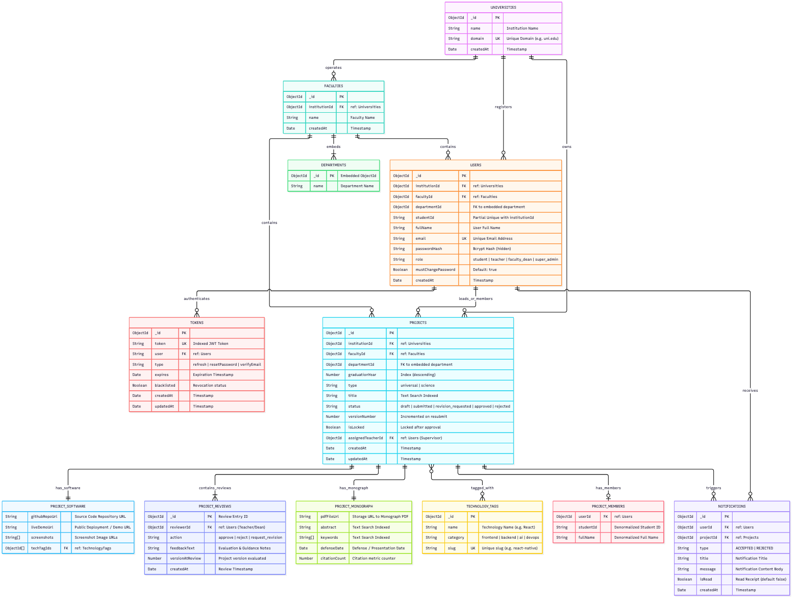
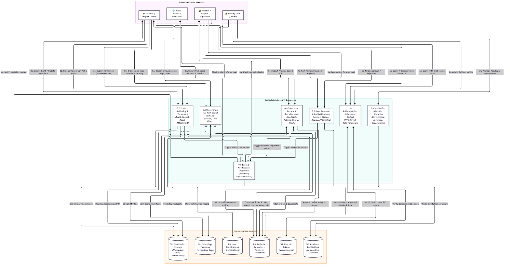
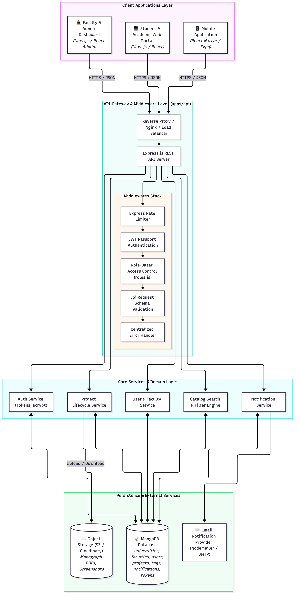
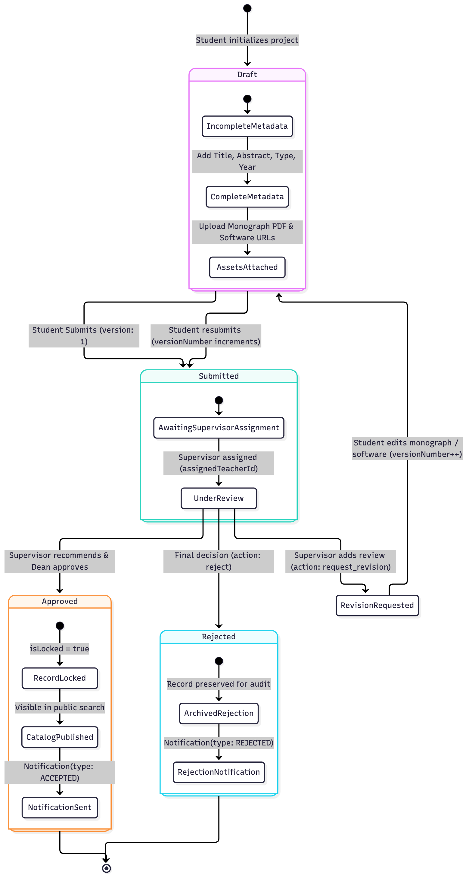

# ProjectsHub - Architecture, Database Schemas & Data Flow

This document provides the definitive architectural blueprint, data dictionary, workflow models, and diagrams for **ProjectsHub**, reflecting the production Mongoose models implemented in `apps/api/src/models/`.

---

## 1. Diagrams Overview

All diagrams are available in high-resolution vector **SVG** (infinitely scalable) and **PNG** raster formats in the [`docs/architecture/diagrams/`](./diagrams/) directory:

| Diagram | Description | Vector SVG | High-Res PNG | Source MMD |
| :--- | :--- | :--- | :--- | :--- |
| **Database Schema / ERD** | Complete 7-collection relational & embedded document model with index constraints | [projects_hub_erd.svg](./diagrams/projects_hub_erd.svg) | [projects_hub_erd.png](./diagrams/projects_hub_erd.png) | [projects_hub_erd.mmd](./diagrams/projects_hub_erd.mmd) |
| **Data Flow Diagram (Level 1)** | End-to-end data pipelines across Students, Teachers, Deans, Guests, and Stores | [projects_hub_data_flow.svg](./diagrams/projects_hub_data_flow.svg) | [projects_hub_data_flow.png](./diagrams/projects_hub_data_flow.png) | [projects_hub_data_flow.mmd](./diagrams/projects_hub_data_flow.mmd) |
| **System Architecture** | Clients, Gateway, Express Middleware pipeline, Domain Services, and Data tier | [projects_hub_system.svg](./diagrams/projects_hub_system.svg) | [projects_hub_system.png](./diagrams/projects_hub_system.png) | [projects_hub_system.mmd](./diagrams/projects_hub_system.mmd) |
| **Project State Machine** | Lifecycle states: draft, submission, review loops, locking, and notifications | [projects_hub_state_machine.svg](./diagrams/projects_hub_state_machine.svg) | [projects_hub_state_machine.png](./diagrams/projects_hub_state_machine.png) | [projects_hub_state_machine.mmd](./diagrams/projects_hub_state_machine.mmd) |

---

## 2. Database Schema & Entity Relationship Diagram (ERD)

The system is built on **MongoDB** via Mongoose, leveraging hybrid modeling (document embedding for atomic sub-resources like monographs, software assets, reviews, and team members; referenced relations for institutional hierarchies and user accounts).

### Diagram Preview


### Collection & Data Dictionary

#### 1. `universities` ([university.model.js](../../apps/api/src/models/university.model.js))
Top-level multi-tenancy / academic institutions.
- `_id`: `ObjectId` (Primary Key)
- `name`: `String` (Required, trimmed)
- `domain`: `String` (Required, unique index, lowercase, e.g., `kabul.edu`)
- `createdAt`: `Date` (Automated timestamp)

#### 2. `faculties` ([faculty.model.js](../../apps/api/src/models/faculty.model.js))
Academic faculties within a university.
- `_id`: `ObjectId` (Primary Key)
- `institutionId`: `ObjectId` (ref `University`, indexed)
- `name`: `String` (Required, trimmed)
- `departments`: `[Department]` (Embedded array of sub-documents):
  - `_id`: `ObjectId` (Embedded sub-document ID)
  - `name`: `String`
- `createdAt`: `Date` (Automated timestamp)

#### 3. `users` ([user.model.js](../../apps/api/src/models/user.model.js))
System user accounts with role-based segregation.
- `_id`: `ObjectId` (Primary Key)
- `institutionId`: `ObjectId` (ref `University`)
- `facultyId`: `ObjectId` (ref `Faculty`)
- `departmentId`: `ObjectId` (FK to embedded department in Faculty)
- `studentId`: `String` (Trimmed, indexed via partial compound unique index `{ studentId: 1, institutionId: 1 }`)
- `fullName`: `String` (Required)
- `email`: `String` (Required, unique index, validated email)
- `passwordHash`: `String` (Bcrypt hash, hidden with `private: true, select: false`)
- `role`: `String` (`student` | `teacher` | `faculty_dean` | `super_admin`)
- `mustChangePassword`: `Boolean` (Default `true` for newly provisioned accounts)
- `createdAt`: `Date` (Automated timestamp)

#### 4. `projects` ([project.model.js](../../apps/api/src/models/project.model.js))
Central repository of monographs and software deliverables.
- `_id`: `ObjectId` (Primary Key)
- `institutionId`: `ObjectId` (ref `University`)
- `facultyId`: `ObjectId` (ref `Faculty`)
- `departmentId`: `ObjectId` (FK to embedded department)
- `graduationYear`: `Number` (Indexed descending for filtering)
- `type`: `String` (`universal` | `science`)
- `title`: `String` (Full-text indexed)
- `status`: `String` (`draft` | `submitted` | `revision_requested` | `approved` | `rejected`)
- `versionNumber`: `Number` (Default `1`, incremented on resubmission)
- `isLocked`: `Boolean` (Locked after approval to prevent tampering)
- `assignedTeacherId`: `ObjectId` (ref `User`, project supervisor)
- `leader`: `Member` (Embedded: `{ userId, studentId, fullName }`)
- `members`: `[Member]` (Embedded array: `[{ userId, studentId, fullName }]`)
- `monograph`: `Monograph` (Embedded sub-document):
  - `pdfFileUrl`: `String` (Remote storage URL)
  - `abstract`: `String` (Full-text indexed)
  - `keywords`: `[String]` (Full-text indexed)
  - `defenseDate`: `Date`
  - `citationCount`: `Number` (Default 0)
- `software`: `Software` (Embedded sub-document):
  - `githubRepoUrl`: `String`
  - `liveDemoUrl`: `String`
  - `screenshots`: `[String]` (Array of image URLs)
  - `techTagIds`: `[ObjectId]` (ref `TechnologyTag`, compound indexed)
- `reviews`: `[Review]` (Embedded timeline of evaluations):
  - `_id`: `ObjectId`
  - `reviewerId`: `ObjectId` (ref `User`)
  - `action`: `String` (`approve` | `reject` | `request_revision`)
  - `feedbackText`: `String`
  - `versionAtReview`: `Number`
  - `createdAt`: `Date`
- `createdAt`: `Date`
- `updatedAt`: `Date`

#### 5. `technology_tags` ([technologyTag.model.js](../../apps/api/src/models/technologyTag.model.js))
Categorized technological tags for faceted project filtering.
- `_id`: `ObjectId` (Primary Key)
- `name`: `String` (e.g., `Node.js`, `TensorFlow`)
- `category`: `String` (e.g., `backend`, `machine_learning`, `mobile`)
- `slug`: `String` (Unique index, e.g., `node-js`, `tensorflow`)

#### 6. `notifications` ([notification.model.js](../../apps/api/src/models/notification.model.js))
User notifications for review events and status transitions.
- `_id`: `ObjectId` (Primary Key)
- `userId`: `ObjectId` (ref `User`, indexed)
- `projectId`: `ObjectId` (ref `Project`)
- `type`: `String` (`ACCEPTED` | `REJECTED`)
- `title`: `String`
- `message`: `String`
- `isRead`: `Boolean` (Default `false`, indexed)
- `createdAt`: `Date` (Indexed)

#### 7. `tokens` ([token.model.js](../../apps/api/src/models/token.model.js))
Authentication and authorization token tracking.
- `_id`: `ObjectId` (Primary Key)
- `token`: `String` (Indexed)
- `user`: `ObjectId` (ref `User`)
- `type`: `String` (`refresh` | `resetPassword` | `verifyEmail`)
- `expires`: `Date`
- `blacklisted`: `Boolean` (Default `false`)
- `createdAt`: `Date`
- `updatedAt`: `Date`

---

## 3. Database Indexes & Query Optimizations

| Index Name / Target | Fields | Type / Option | Purpose |
| :--- | :--- | :--- | :--- |
| **Catalog Full-Text Search** | `{ title: "text", "monograph.abstract": "text", "monograph.keywords": "text" }` | Text Index | Powers fast search queries for title, abstract, and research keywords |
| **Public Catalog Filtering** | `{ status: 1, graduationYear: -1, facultyId: 1, departmentId: 1, "software.techTagIds": 1 }` | Compound Index | Optimizes catalog filters by year, department, tags, and approval status |
| **Leader Projects** | `{ "leader.userId": 1 }` | Single Field Index | Rapid lookup of projects where user is leader |
| **Member Projects** | `{ "members.userId": 1 }` | Single Field Index | Rapid lookup of projects where user is a team member |
| **Student ID Uniqueness** | `{ studentId: 1, institutionId: 1 }` | Unique Partial (`studentId: { $type: "string" }`) | Enforces unique student IDs per institution while ignoring staff accounts |
| **Active Notifications** | `{ userId: 1, isRead: 1, createdAt: -1 }` | Compound Index | Fast retrieval of unread notifications sorted newest first |

---

## 4. End-to-End Data Flow (DFD Level 1)

The Data Flow Diagram illustrates how information moves across external entities, processes, and persistent datastores:

### Diagram Preview


### Key Flows
1. **Onboarding & Auth (1.0)**:
   - Users authenticate with institutional email or Student ID.
   - Passwords verified with Bcrypt; JWT access tokens (short-lived) and refresh tokens (persisted in `tokens`) issued.
2. **Project Authoring & Media (3.0)**:
   - Students create draft projects, add team members, and link technology tags.
   - Monograph PDFs and software screenshots are stored in Cloud Object Storage; URLs recorded in the project document.
3. **Supervisor Review Loop (4.0)**:
   - Upon submission (`status: submitted`), a review assignment alerts the supervisor.
   - The supervisor evaluates deliverables and appends an immutable review entry (`approve`, `request_revision`, or `reject`).
   - If revisions are required, the project status shifts to `revision_requested`, allowing student edits while incrementing `versionNumber`.
4. **Approval & Catalog Publishing (5.0)**:
   - Final approval sets `status: approved` and `isLocked: true`.
   - Generates an `ACCEPTED` notification in `notifications`.
   - The project immediately surfaces in the public discovery index.
5. **Catalog Search & Discovery (6.0)**:
   - Public visitors and students query approved projects with faceted search (year, faculty, technology tags, and full-text keywords).

---

## 5. System Architecture & Topology

ProjectsHub is organized as a modular monorepo containing web, mobile, shared packages, and the core REST API:

### Diagram Preview


```text
Clients:
  ├── Web Portal (Next.js / React)
  ├── Admin Panel (Next.js / React)
  └── Mobile Application (React Native / Expo)
         │
         ▼ (HTTPS / REST)
API Gateway & Express Server (apps/api):
  ├── Middleware Pipeline (Rate Limit -> JWT Auth -> RBAC -> Joi Validation -> Error Handling)
  └── Services (Auth, User, Faculty, Project, Search, Notification)
         │
         ├───► MongoDB Cluster (universities, faculties, users, projects, tags, notifications, tokens)
         ├───► Object Storage (Monograph PDFs & Application Screenshots)
         └───► SMTP Email Service (Account Invitations & Alerts)
```

---

## 6. Project Lifecycle State Machine

### Diagram Preview


### State Transitions

```text
[ * ]
  │
  ▼
[ DRAFT ] ───────────► (Student Submits) ───────────► [ SUBMITTED ]
  ▲                                                          │
  │ (Student Resubmits                                       ▼
  │  versionNumber++)                                   [ UNDER REVIEW ]
  │                                                      │          │
  └───── [ REVISION_REQUESTED ] ◄── (Teacher Review) ────┘          │
                                                                    ▼
                                                  (Dean Approval / Final Decision)
                                                           │              │
                                                           ▼              ▼
                                                     [ APPROVED ]    [ REJECTED ]
                                                     (isLocked=true) (Archived)
```

---

## 7. Re-generating or Updating Diagrams

All diagrams can be regenerated whenever models change using `@mermaid-js/mermaid-cli`:

```bash
# Generate both SVG and high-res PNG for all diagrams
cd docs/architecture/diagrams

# ERD
npx -y @mermaid-js/mermaid-cli -i projects_hub_erd.mmd -o projects_hub_erd.svg -b "#ffffff"
npx -y @mermaid-js/mermaid-cli -i projects_hub_erd.mmd -o projects_hub_erd.png -s 2 -b "#ffffff"

# Data Flow Diagram
npx -y @mermaid-js/mermaid-cli -i projects_hub_data_flow.mmd -o projects_hub_data_flow.svg -b "#ffffff"
npx -y @mermaid-js/mermaid-cli -i projects_hub_data_flow.mmd -o projects_hub_data_flow.png -s 2 -b "#ffffff"

# State Machine
npx -y @mermaid-js/mermaid-cli -i projects_hub_state_machine.mmd -o projects_hub_state_machine.svg -b "#ffffff"
npx -y @mermaid-js/mermaid-cli -i projects_hub_state_machine.mmd -o projects_hub_state_machine.png -s 2 -b "#ffffff"

# System Topology
npx -y @mermaid-js/mermaid-cli -i projects_hub_system.mmd -o projects_hub_system.svg -b "#ffffff"
npx -y @mermaid-js/mermaid-cli -i projects_hub_system.mmd -o projects_hub_system.png -s 2 -b "#ffffff"
```
